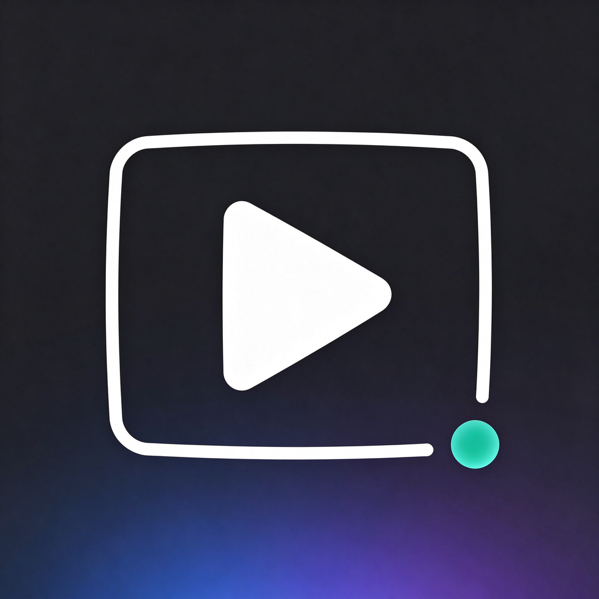

# Reality

一个从零写的 iOS 原生 Emby 客户端：SwiftUI + AVPlayer，直连你自己的 Emby 服务器。
仓库自带 GitHub Actions 工作流，push 上去就自动编译出**未签名 `.ipa`**，下载后自行签名安装。

<p></p>

## 功能

- 账号密码登录任意 Emby 服务器（`/Users/AuthenticateByName`），token 存本地，失效自动回登录页
- 底部四个导航：主页 / 我的 / 媒体库 / 设置
- 媒体库：未连接时是「添加资源库」空状态；连接后是媒体库卡片墙，点进去是电影/剧集海报墙，分页加载，支持按名称 / 最近添加 / 年份排序
- 主页：继续观看 + 各媒体库的最近添加
- 我的：头像、账号、媒体库/待续播统计、退出登录
- 详情：背景图、简介、季切换、分集列表、单集续播进度
- 搜索：片名 / 剧名 / 单集，输入防抖
- 播放：能直连就直连（`Static=true`），不行才走服务端 HLS 转码；系统播放器控件，支持 AirPlay / 画中画
- 音轨、字幕切换（切换后从当前位置重新拉流）
- 播放进度每 10 秒上报一次，暂停/退出/播完立即上报，多设备「继续观看」同步
- 剧集播完可直接跳下一集

## 出包流程（GitHub Actions）

1. 推送代码（仓库已建好时）：

```bash
git remote add origin https://github.com/<你的账号>/Reality.git   # 已配置则跳过
git push -u origin main
```

2. 打开仓库 **Actions** 页，`Build IPA` 会在 push 时自动跑，也可手动 `Run workflow`。
3. 跑完后在该次 run 的 **Artifacts** 里下载 `Reality-unsigned-ipa`，里面是 `Reality-unsigned.ipa`。
4. 推 `v1.0` 这类 tag 时，工作流还会把 ipa 直接附到 GitHub Release 上。

工作流做的事：`macos-15` runner → `brew install xcodegen` → 生成 `.xcodeproj` → `xcodebuild` 关闭代码签名编译 → 打成 `Payload/Reality.app` 的 zip，即标准 ipa 结构。

## ipa 怎么装到 iPhone

未签名 ipa 不能直接双击安装，选一种：

| 方式 | 说明 |
| --- | --- |
| Sideloadly / AltStore（免费 Apple ID） | 电脑上签名后推送到手机，**7 天后需重签**，最多同时装 3 个自签 App |
| 付费开发者账号 / 证书签名 | 用 `codesign` + provisioning profile 重签，有效期 1 年 |
| TrollStore | 支持的 iOS 版本上无需签名，永久安装 |

想让 CI 直接出「已签名」的 ipa，可在仓库 Secrets 放 `BUILD_CERTIFICATE_BASE64` / `P12_PASSWORD` / `PROVISIONING_PROFILE_BASE64`，在 `Package into .ipa` 前插入 `security import` + `codesign -f -s "Apple Development: xxx"`。默认工作流故意不碰签名，任何人都能跑通编译。

## 本地开发

需要 macOS + Xcode 16：

```bash
brew install xcodegen
xcodegen generate
open Reality.xcodeproj
```

真机调试时在 Xcode 里给 target 选一个 Team（`project.yml` 的 `DEVELOPMENT_TEAM` 留空，或在 Signing & Capabilities 里改）。

改 Bundle ID：编辑 `project.yml` 的 `PRODUCT_BUNDLE_IDENTIFIER`（当前 `com.example.reality`），重新 `xcodegen generate`。

## 目录结构

```
project.yml                     # 工程定义（XcodeGen），改配置只改这里
Support/Info.plist              # 由 xcodegen 生成：ATS 明文放行、后台音频、局域网权限
.github/workflows/build-ipa.yml # 编译 + 打包 + artifact / Release
Reality/
  RealityApp.swift              # 入口 / 根视图
  Models/EmbyModels.swift       # 解码模型
  Services/SessionStore.swift   # 会话与 deviceId 持久化
  Services/EmbyClient.swift     # Emby REST + 播放地址决策 + 进度上报
  Services/PlaybackModel.swift  # AVPlayer 生命周期、续播、下一集
  Views/
    MainTabView.swift           # 四个底部导航 + 路由注册
    HomeView.swift              # 主页
    MediaLibraryTab.swift       # 媒体库（空状态 / 资源库卡片墙）
    AddServerSheet.swift        # 添加服务器（Emby 登录）
    ProfileView.swift           # 我的
    LibraryView.swift           # 海报墙
    DetailView.swift            # 详情 / 季集
    PlayerScreen.swift          # 播放器
    SearchView.swift            # 搜索
    SettingsView.swift          # 设置
```

## 播放策略

AVPlayer 在 iOS 上只认有限格式，`EmbyClient.buildPlan` 先判断：

- 容器 `mp4/m4v/mov`、视频 `h264/hevc`、音频 `aac/mp3/ac3/eac3/alac` → 直连 `/Videos/{id}/stream.{ext}?Static=true`，原画质、可拖动、几乎不占 CPU；
- 其他（MKV、AVI、DTS/TrueHD 音轨等）→ `/Videos/{id}/master.m3u8` 由服务端实时转成 H.264 + AAC 的 HLS。

字幕：默认让服务端把文本字幕作为 HLS 独立轨道输出（系统播放器「字幕」菜单可切）；在「声音与字幕」里手动指定的轨道用 `SubtitleMethod=Encode` 压进画面（PGS/VobSub 只能这样）。

## 已知限制

- 代码按 Emby 官方 REST 接口手写，**没有在真实服务器上回归过**（生成环境没有 Emby 实例）；首次编译或首播报错，把 Actions 日志贴回来即可修
- 没做收藏、评分、演员页、合集、播放列表、离线下载、多用户切换
- 图形字幕压进画面后不能单独关闭
- 不支持 Emby Connect 云账号登录，只能用服务器地址 + 账号
- 明文 HTTP 已放行（`NSAllowsArbitraryLoads`），建议只在内网或自建反代下用；公网请走 HTTPS

## 隐私

代码里没有任何硬编码的服务器地址或凭证。登录信息只存在本机 `UserDefaults`，请求只发往你填的那台服务器。
